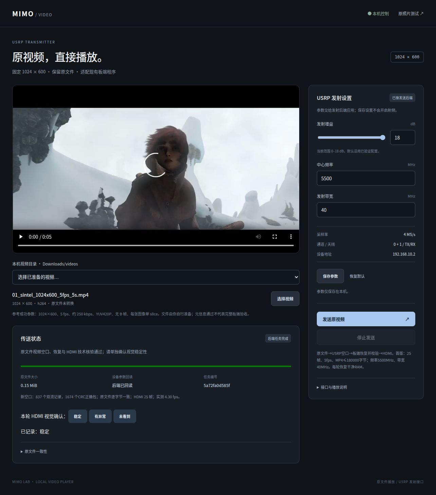
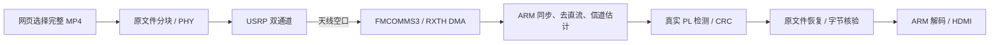

# USRP–ZedBoard 2×2 MIMO 原文件视频空口与 HDMI

**参赛方向：AMD 自主选题赛道 · 初级组。** 按用户提供指南第 3.3 节组织，器件 Zynq-7000、Vivado 2025.2；实现不强制使用 PYNQ，本作品不申报未经验证的 PYNQ 加分。

本作品以 USRP 为发送端，ZedBoard＋FMCOMMS3 为接收端，将当前已验证的 2×2 MIMO / PL 检测链路接入本机网页，实现照片和有限原 MP4 文件空口传输、恢复与 HDMI 播放。

**本版为已验收的完整工程交付版：有限视频完整接收后再播放。** 网页保留用户原 MP4 字节，不转码；接收端完整校验后正常解封装/解码。源标称 5 fps，物理播放采用实测值，持续实时不在本版功能范围。

## 比赛审阅入口

- [设计报告：框图、软硬划分、优化、资源/时序](report/design_report.md)
- [复现说明：下载、恢复、构建、网页演示](report/reproduction.md)
- [当前功能源码](src/readme.md)
- [技能包：工作流、校验脚本、模板、排错](skill/readme.md)
- [验收与失败边界](report/limitations.md) · [证据入口](sim/readme.md)
- [迁移保留/剔除范围](report/selection.md) · [第三方来源](report/third_party.md)

## 已验证结果

| 项目 | Sintel | Big Buck Bunny |
|---|---:|---:|
| 原 MP4 大小 | 153160 字节 | 141378 字节 |
| 唯一双流 RF 帧 | 834 | 770 |
| CRC 正确包 | 1674 | 1546 |
| 新 ADC | 5120 块 | 5120 块 |
| 原文件恢复 | 逐字节一致 | 逐字节一致 |
| HDMI 物理呈现 | 25 帧 | 25 帧 |
| 实测物理播放 | 约 4.30 fps | 约 4.49 fps |
| 用户观察 | 连续变化，稳定 | 连续变化，稳定 |

测试源为 1024×600、25 帧、标称 5 fps 的 5 秒兼容 H.264 MP4，最大 180000 字节。原始 ADC/RFD/参考文件、文件哈希与独立审计都保留。所有历史失败未从索引中删除。



上图是网页技术结果；物理 HDMI 视觉反馈单独保存，不将网页截图当作显示器照片。

## 数据路径



## 获取与检查

```bash
git clone https://github.com/liyuan717/usrp-zedboard-mimo-hdmi.git
cd usrp-zedboard-mimo-hdmi
python3 build/scripts/verify.py
python3 build/scripts/download_assets.py
python3 build/scripts/verify.py --assets
python3 build/scripts/restore_workspace.py --output /tmp/mimo_competition
```

源码、报告及技能可直接浏览。固定运行资产用 Git LFS 单独保存；工具链和完整历史开发树不重复打包。恢复脚本不会改动现有工作区或 SD；**完整演示仍需符合记录的部署路径、板端环境和连接配置**，详见复现说明。

## 实现与验证

XC7Z020 routed 资源：LUT 43781/53200（82.30%）、FF 45.57%、BRAM 16.07%、DSP 18.64%；WNS +0.160 ns、WHS +0.010 ns、TNS/THS=0。45 条自有 RTL/约束、18 项配方、102 条 ADI 输入身份已核对。

原验证已有 31 项主机回归、7 项技能正负例、ARM 字节一致回建、DCP 配置 payload 一致回建、新 Vivado 工程/BD 生成。迁移完成新目录恢复、ARM 字节回建、25 AU ARM 离线解码及新 Vivado 工程/BD 校验；实板功能沿用保存的两轮新空口验收。

本仓库保留当前功能主线，不导入未完成分支、历史提交或重复归档。根文件名及提交目录采用英文小写，源码大小写通过恢复映射还原。

## 按指南组织的目录

| 指南目录 | 本仓库内容 |
|---|---|
| src/ | 当前功能源码、协议及实际使用的 vendor IP；原路径/大小写可恢复 |
| sim/ | 离线验证、代表性失败及全部历史检查点索引 |
| build/ | 源码清单、构建/恢复/校验脚本与综合/实现报告 |
| board/ | 运行资产清单、实板回执、参考网页截图 |
| data/ | 单一固定运行/参考数据包（Git LFS）及 SHA256 |
| skill/ | 工作流、校验脚本、模板与排错清单 |
| report/ | 设计/性能/创新背景、协作记录、复现及比赛要求对照 |

另有 third_party/ 许可证和根 license；所有新路径使用英文小写，README 文件以 readme.md 命名。源码在恢复时还原 CMakeLists 等必要大小写。

指南要求对照：[初级组提交清单](report/requirements.md)；评测权重与证据：[30/20/20/15/15 对照](report/scoring_evidence.md)。本工程按自主选题初级组组织，报名信息由队伍在赛事系统提交。

本版交付清单见[版本说明](report/release.md)；背景、状态机及接口、性能表、协作案例和技能提炼均在 report/。另附[决赛英文海报文案](report/poster_content_en.md)，可用于官方 PPT 模板。
