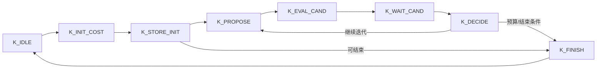

# 初级组重点：逻辑、状态机、时序与接口

## 数据通路与软硬划分

PS 做同步、去直流、频偏/采样偏差处理及信道估计，将固定点检测任务交给 PL；PL 运行既有 2×2 检测核心，结果回 PS 做包/CRC 和文件恢复。RTL、AXI、DMA 与 ARM 编排共同组成作品，网页是操作入口。

核心源码入口：`src/fpga/pl/rtl/`、`src/receiver/`、`src/drivers/`。恢复脚本还原原大小写/相对路径后再构建。

## 检测状态机

`mimo_mhgd_kernel_2x2.sv` 的实际状态包括：

空闲接收任务时快照调制、预算和矩阵/向量数据，避免后续输入改变在途计算；flush 复位控制器和子数据通路。此图是状态流说明，实际条件、饱和/溢出和结果有效时序以源码为准，不以图代替 RTL。

## RXTH 分块与握手

`rf_rx_transport_framer.v` 采用 ST_IDLE、ST_COLLECT、ST_HDR0..ST_HDR3、ST_PAYLOAD。默认 1024 个 64-bit 采样向量加 32 字节头，共 8224 字节/块；头含 epoch、block sequence、首采样编号、有效计数及 CRC。

先收完整的不可变块，再在 AXI-Stream 握手下发送头和负载；TLAST 标记块尾。采集期 flush 丢未提交块，发送期完成当前块，不把新 epoch 的样本拼进旧头。消费者检查头 CRC/连续性/有效性，不拿填零无效块冒充正确 IQ。

## 接口与资源所有权

AXI4-Lite 用于控制/状态，AXI-Stream 承载帧/结果，DMA 与匹配 UAPI/驱动配对；RXTH、检测和 HDMI 不靠重复抢占同一个设备节点来协调。已验收拓扑将 HDMI DMA 接 HP1，RF/RXTH/检测通路保留 HP0。地址、IRQ、寄存器布局以配对 DTB、XSA、UAPI 和源 Tcl 为准。

停止按先 TX、再板端任务/采集、再 LO 与资源确认顺序执行；清理未确认则不能把下一轮记为干净基线。CSR/状态机、CDC、DMA 及显示的证据边界分别记录。

## 约束与实现

在 Vivado 2025.2 / XC7Z020CLG484-1 routed 报告中，WNS +0.160 ns、WHS +0.010 ns、TNS/THS=0。静态报告含 FCLK 50 MHz、delay 200 MHz、HDMI 时钟约 148.148 MHz、RF 接口约 16 MHz；运行采样率与实际 EDID 时序另从现场配置确认。LUT 82.30% 等资源见性能报告。

源码内的 CDC/约束与报告保留；不能只看 timing summary 就忽略 bus-skew、例外或模式变化。最高频率、持续 RF 吞吐和视觉稳定性不能由 WNS 或 LUT 使用率直接推出。
